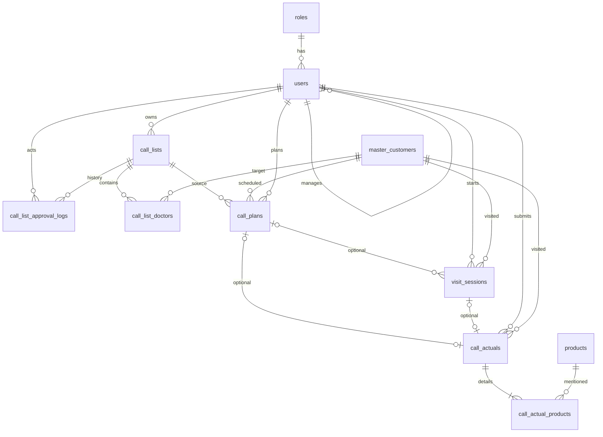

# Database Schema & Constraint Specification — MSF

> **Versi:** 1.5, design only (belum diuji MySQL).  
> **DB:** MySQL **8.0.16+**, InnoDB, FK enabled, utf8mb4.  
> **Jumlah tabel domain baseline:** **11**, termasuk `visit_sessions` P1. P0 boleh memakai 10 tabel terlebih dahulu selama struktur final kompatibel.  
> **Conventions:** `BIGINT UNSIGNED` untuk ID; full datetime UTC `DATETIME(6)`; `visit_date` local Asia/Jakarta DATE; periode disimpan sebagai tanggal pertama bulan.

## 1. ERD



## 2. Tabel dan field minimum

**`roles`**: `code VARCHAR(16) PRIMARY KEY` (`mr`, `dm`, `rsm`, `mm`), `name VARCHAR(100)`.

**`users`**: `id PK`, `name`, `email UNIQUE`, `password`, `role FK -> roles.code`, `region_id` (nullable jika demo), `manager_id NULL FK -> users.id`, timestamps. Parent-child manager relationship divalidasi service, bukan FK role hierarchy.

**`master_customers`**: `id PK`, `name`, `specialization`, `address`, `phone`, timestamps (optional). ID adalah doctor ID dalam Call List/Plan/Actual.

**`products`**: `id PK`, `name`, `category`, timestamps (optional).

**`call_lists`**: `id PK`, `owner_id FK users`, `period_month DATE`, `status VARCHAR(24)` (`draft`,`pending_approval`,`approved`), `assigned_approver_id NULL FK users`, `submitted_at NULL`, `approved_at NULL`, timestamps. `UNIQUE(owner_id,period_month)` dan candidate `UNIQUE(id,owner_id)`.

**`call_list_doctors`**: `call_list_id FK call_lists`, `doctor_id FK master_customers`, `PRIMARY KEY(call_list_id, doctor_id)`.

**`call_list_approval_logs`**: `id PK`, `call_list_id FK`, `actor_id FK users`, `event VARCHAR(32)`, `event_origin VARCHAR(24)` (`user_action`,`system_transition`), `from_status`, `to_status`, `reason NULL`, `created_at`. Append-only. `actor_id` bagi system transition adalah user pemicu workflow, **bukan** pengambil keputusan yang belum bertindak.

**`call_plans`**: `id PK`, `call_list_id`, `mr_id FK users`, `doctor_id FK master_customers`, `plan_date DATE`, `planned_time TIME`, `status VARCHAR(20)` (`scheduled`,`completed`,`cancelled`), `cancellation_reason NULL`, `cancelled_at NULL`, timestamps. FKs komposit ke List dan List Doctors untuk integritas owner/target; conditional generated unique doctor/date.

**`visit_sessions`** **P1**: `id PK`, `mr_id FK users`, `plan_id NULL FK call_plans`, `doctor_id FK master_customers`, `visit_date DATE`, `check_in_at DATETIME(6)`, `check_out_at NULL DATETIME(6)`, `status VARCHAR(20)` (`in_progress`,`completed`,`cancelled`), `draft_payload JSON NULL`, `draft_revision INT UNSIGNED DEFAULT 0`, `cancellation_reason NULL`, `cancelled_at NULL`, `completed_at NULL`, timestamps. Generated active doctor and active Plan unique.

**`call_actuals`**: `id PK`, `mr_id FK users`, `plan_id NULL FK call_plans`, `visit_session_id NULL FK visit_sessions`, `doctor_id FK master_customers`, `visit_date DATE`, `check_in_at DATETIME(6)`, `check_out_at DATETIME(6)`, `visit_type VARCHAR(20)` (`planned`,`unplanned`,`non_target`), `photo_url TEXT`, `signature_url TEXT`, `visit_reason TEXT NULL`, `deviation_reason TEXT NULL`, `created_at`, `updated_at`. `UNIQUE(doctor_id, visit_date)`, `UNIQUE(plan_id)`, `UNIQUE(visit_session_id)`.

**`call_actual_products`**: `call_actual_id FK call_actuals`, `product_id FK products`, `PRIMARY KEY(call_actual_id, product_id)`. Tidak boleh membuat Actual final tanpa setidaknya satu relasi produk—validasi dilakukan service dalam transaction.

## 3. Constraint dan candidate keys

| Tabel | Key | Purpose |
|---|---|---|
| users | `UNIQUE(email)` | Identitas login |
| call_lists | `UNIQUE(owner_id,period_month)` | Satu List/bulan/owner (asumsi) |
| call_lists | `UNIQUE(id,owner_id)` | Target composite FK Plan |
| call_list_doctors | `PRIMARY KEY(call_list_id,doctor_id)` | Dokter anggota List |
| call_plans | `UNIQUE(id,mr_id,doctor_id)` | Candidate key untuk Session/Actual |
| call_plans | `UNIQUE(active_doctor_id,plan_date)` | Satu non-Cancelled Plan global dokter/tanggal |
| visit_sessions | `UNIQUE(id,mr_id,doctor_id,visit_date)` | Candidate key untuk Actual |
| visit_sessions | `UNIQUE(active_doctor_id,visit_date)` | Satu Session aktif dokter/tanggal |
| visit_sessions | `UNIQUE(active_plan_id)` | Satu Session aktif per Plan |
| call_actuals | `UNIQUE(doctor_id,visit_date)` | Satu final Actual global per dokter/hari |
| call_actuals | `UNIQUE(plan_id)` | Plan tidak selesai dua kali |
| call_actuals | `UNIQUE(visit_session_id)` | Session tidak selesai dua kali |
| call_actual_products | `PRIMARY KEY(call_actual_id,product_id)` | Anti-double product relation |

**Composite FKs (migrasi berurutan):**

- `call_plans(call_list_id,mr_id)` → `call_lists(id,owner_id)`.
- `call_plans(call_list_id,doctor_id)` → `call_list_doctors(call_list_id,doctor_id)`.
- `visit_sessions(plan_id,mr_id,doctor_id)` → `call_plans(id,mr_id,doctor_id)` (jika plan_id non-null).
- `call_actuals(plan_id,mr_id,doctor_id)` → `call_plans(id,mr_id,doctor_id)` (jika plan_id non-null).
- `call_actuals(visit_session_id,mr_id,doctor_id,visit_date)` → `visit_sessions(id,mr_id,doctor_id,visit_date)` (jika session non-null).

**PENTING:** MySQL composite FK yang mempunyai `NULL` tidak memaksa seluruh hubungan; service tetap perlu memeriksa `visit_sessions.plan_id` **sama dengan** `call_actuals.plan_id` termasuk jika salah satu null. Foreign keys tidak memeriksa status parent Approved, role atau periode; validasi tersebut wajib di service.

## 4. DDL contoh generated columns (belum diuji)

```sql
-- P0: Plan non-Cancelled menahan slot global doctor + date.
ALTER TABLE call_plans
ADD COLUMN active_doctor_id BIGINT UNSIGNED
  GENERATED ALWAYS AS (
    CASE WHEN status IN ('scheduled','completed') THEN doctor_id ELSE NULL END
  ) STORED,
ADD UNIQUE KEY uq_plan_active_day (active_doctor_id,plan_date);

-- P1: unique hanya untuk Session In Progress.
ALTER TABLE visit_sessions
ADD COLUMN active_doctor_id BIGINT UNSIGNED
  GENERATED ALWAYS AS (
    CASE WHEN status='in_progress' THEN doctor_id ELSE NULL END
  ) STORED,
ADD COLUMN active_plan_id BIGINT UNSIGNED
  GENERATED ALWAYS AS (
    CASE WHEN status='in_progress' THEN plan_id ELSE NULL END
  ) STORED,
ADD UNIQUE KEY uq_session_active_day (active_doctor_id,visit_date),
ADD UNIQUE KEY uq_session_active_plan (active_plan_id);

-- P0/P1: Unique Actual final global + optional link 1:1.
ALTER TABLE call_actuals
ADD UNIQUE KEY uq_actual_doctor_day (doctor_id,visit_date),
ADD UNIQUE KEY uq_actual_plan (plan_id),
ADD UNIQUE KEY uq_actual_session (visit_session_id);
```

Index/filter tambahan: `call_lists(owner_id,period_month,status)`, `call_lists(assigned_approver_id,status)`, `call_plans(mr_id,plan_date)`, `visit_sessions(mr_id,status)`, `call_actuals(mr_id,visit_date)`, `call_list_approval_logs(call_list_id,created_at)`.

**CHECK constraints** yang bisa dipasang di MySQL 8.0.16+: period first-day-of-month, status domain, `check_out_at > check_in_at` untuk Actual dan jika Session Checkout tidak null, `draft_revision >= 0`. Dalam migration, perhatikan operator/versi SQL dan keterbatasan CHECK. Test nyata sangat diperlukan.

## 5. Cross-table invariants (harus di service)

- Direct manager/assigned approver sah dan List Pending sebelum approval.
- Dokter Call Plan bagian dari Approved List owner, tanggal dalam bulan List.
- Min satu product pada Actual, foto/signature bukan string kosong.
- Actual final unique doctor/date melintasi semua mode dan MR.
- Check-in tidak boleh sama/lebih akhir dari Check-out.
- Planned Actual sesuai owner/doctor/list/status Plan dan, jika perlu, deviation reason.
- `plan_id = null` dari dokter MCL tetap sah tanpa approved list.
- As-of classification `approved_at <= check_in_at` untuk Unplanned.
- Session-based Actual harus sinkron dengan Session terkait; direct Actual tidak boleh menerobos active Session.
- Actual tanpa Plan tidak mengubah Plan Scheduled lain.
- Dilarang delete cascade histori approval/Plan/Actual, gunakan RESTRICT/no delete API.

## 6. Atomicity dan concurrency

Gunakan lock `master_customers` row dokter `FOR UPDATE` dalam transaksi setiap operasi kritis: create/cancel Plan, start/save/checkout/cancel Session, finalisasi Actual. Setelah lock, **cek ulang** existing Plan, Actual dan Session; jangan percaya hasil `GET availability` yang dibuat sebelumnya. Finalisasi Actual + pivot products + status Plan/Session harus commit/rollback bersama.

Urutan lock untuk operasi visit: Doctor → Plan (jika ada) → Session (jika ada). Approval berbeda, lock Call List. Unique constraint adalah pertahanan terakhir setelah service check.

## 7. Seed/demo requirements

- Roles `mr`, `dm`, `rsm`, `mm`.
- Synthetic users membentuk jalur manager: MR→DM→RSM→MM, dan MR kedua untuk negative test lintas user.
- 5+ dokter MCL valid; 3+ products.
- Contoh List draft/pending/approved dan Approved target dokter (bila diperlukan demo).
- Hindari data pasien nyata, informasi perusahaan internal, atau secret dalam seed.

## 8. Migration/test checklist

- [ ] `migrate:fresh --seed` bekerja dengan **MySQL**, bukan hanya SQLite.
- [ ] Semua composite FK benar dan cascade/restrict sesuai tujuan.
- [ ] Status CHECK dan conditional unique bekerja pada MySQL target.
- [ ] Duplicate List owner/month ditolak.
- [ ] Duplicate Plan doctor/date global ditolak, Cancelled tidak memblokir Plan baru.
- [ ] Duplicate Actual doctor/date global ditolak.
- [ ] Session active double check-in lintas MR ditolak (P1).
- [ ] FK Planned parent identity tidak bisa disiasati.
- [ ] Actual + product rollback atomic.
- [ ] Race plan/session/actual disimulasikan (P1).

**Belum ada bukti di atas PASS sebelum migration dan test dijalankan.**
