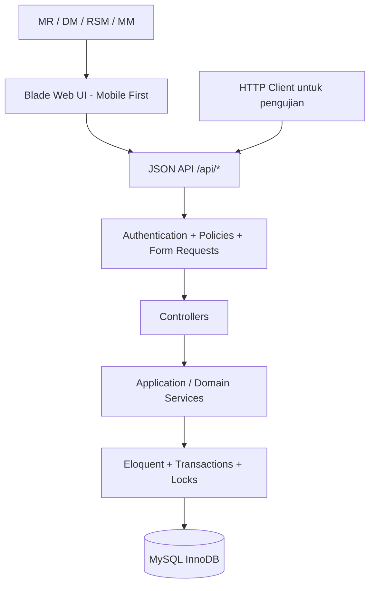
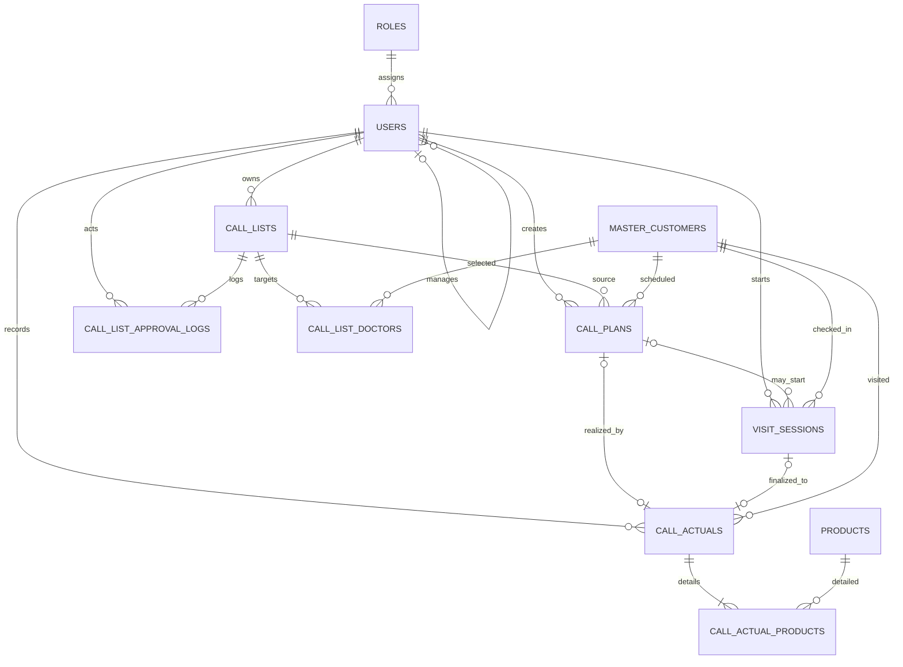
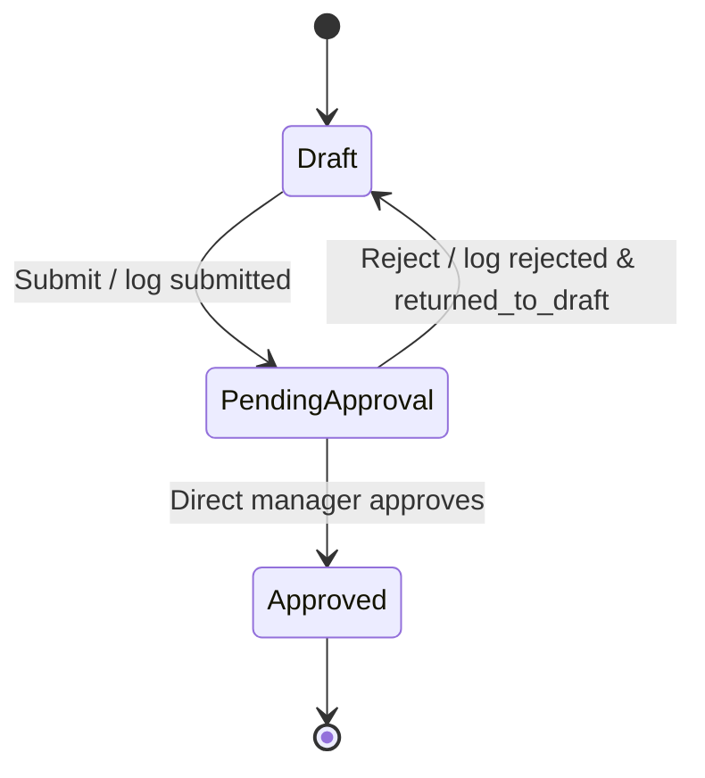

# DESIGN.md — Mobile Sales Force (MSF)

> **Status:** Design baseline v1.5 + UI label amendment v1.6 · **Implementasi:** belum dimulai · **Bahasa:** Indonesia  
> **Acuan:** studi kasus Software Engineer MSF; baseline bisnis/teknis v1.5 dan penegasan label UI v1.6 pada PRD, TDD, dan AGENTS; API Contract v1.0; Database Constraint Specification v1.0.  
> **Kegunaan dokumen:** spesifikasi teknis induk untuk implementasi, code review, testing, dan demo. `README.md` tetap digunakan untuk instruksi instalasi dan laporan hasil pengujian.

## 1. Ringkasan desain

MSF mendukung tiga proses utama: **Call List** (target bulanan), **Call Plan** (jadwal dari target yang disetujui), dan **Call Actual** (realisasi kunjungan). Alur operasional dirancang **Planned-first**: jadwal hari ini dan sesi kunjungan yang sedang berlangsung langsung terlihat di halaman Call Actual. Terdapat satu pilihan sekunder **Kunjungan di Luar Rencana**, yang diklasifikasikan oleh server menjadi **Unplanned** atau **Non Target**.

Prinsip: **pengalaman MR sederhana, validasi backend ketat**. Kunjungan tanpa Plan tetap sah (`plan_id = null`) agar sesuai kontrak studi kasus. Seluruh jenis kunjungan wajib memenuhi bukti foto, tanda tangan, minimal satu produk, dan keunikan Actual **global per dokter per tanggal**.

### 1.1 Prioritas

| Prioritas | Cakupan | Keputusan |
|---|---|---|
| **P0 — wajib** | 8 endpoint studi kasus, master data + migration/seed, Call List + approval, Call Plan, Call Actual termasuk `plan_id=null`, 3 halaman responsif, input check-in/out, loading/error, 5 tes manual, README | Harus selesai lebih dahulu |
| **P1 — setelah P0 stabil** | Visit Session persisten, Resume, Check-out waktu server, Save Draft, Cancel/Recovery, advanced Schedule Deviation UX dan conflict UX, automated tests kritis | Tidak boleh menghalangi Direct API P0 |
| **P2 — opsional** | Dashboard tambahan, copy daftar bulan lalu, offline sync, GPS, deployment, reminder otomatis | Tidak menjadi dependency MVP |

**Sumber requirement:** aturan dan deliverable wajib berasal dari studi kasus; P1 dan kebijakan operasional yang tidak disebut secara eksplisit merupakan **asumsi desain**, bukan syarat baru dari pemberi kasus. Seluruh asumsi yang diimplementasikan harus diringkas di `README.md`.

## 2. Arsitektur

**Stack:** PHP/Laravel, Blade, JavaScript ringan (opsional Alpine.js), MySQL 8.0.16+ (InnoDB). Repository monolith; HTML dan API JSON berada pada aplikasi yang sama. Tidak perlu microservices, queue, event bus, atau frontend SPA terpisah.



**Pembagian tanggung jawab:**

- **Blade/JavaScript:** navigasi, form, indikator loading, pesan error, status penyimpanan, recovery; bukan sumber kebenaran bisnis.
- **Controllers/Form Requests:** parsing JSON, validasi format, kebijakan izin pada objek, respons HTTP.
- **Domain services:** `CallListService`, `CallListApprovalService`, `CallPlanService`, `CallActualService`; `VisitSessionService` dan `ScheduleAvailabilityService` untuk P1. Satu aturan bisnis jangan diduplikasi pada beberapa controller.
- **Database:** foreign key, unique key, CHECK yang didukung MySQL, locking, atomic transaction, audit history.

**Autentikasi:** Laravel session authentication. Endpoint `/api/*` yang dipanggil melalui browser **harus secara eksplisit** berada di bawah middleware session/cookie, auth, dan CSRF yang sesuai; jangan mengandalkan route API stateless default. HTTP client pengujian perlu cookie sesi dan token CSRF, dengan panduan di README. Role bukan pengganti verifikasi `manager_id` dan ownership objek.

## 3. Aktor dan batas akses

| Aktor | Hak utama | Batasan |
|---|---|---|
| **MR** | Buat/edit/submit Call List; buat Plan; catat Actual miliknya | Tidak approve sendiri, tidak menggunakan Plan MR lain |
| **DM** | Approve/Reject Call List MR bawahan langsung | Bukan semua MR; memiliki Call List pribadi **hanya menurut asumsi** untuk mendemonstrasikan hierarchy |
| **RSM** | Approve/Reject Call List DM bawahan langsung | Tidak dapat melompati DM untuk approve List MR; dapat membuat Call List pribadi sebagai asumsi |
| **MM** | Approve/Reject Call List RSM bawahan langsung | Tidak membuat Plan/Actual |

`users.manager_id` menjadi hubungan otoritas langsung. Saat submit pertama, `assigned_approver_id` disimpan sebagai snapshot; setelah reject lalu resubmit tetap diarahkan kepada approver yang sama dalam siklus itu. Apabila hubungan organisasi berubah di tengah siklus, reassignment adalah di luar scope MVP dan harus dinyatakan sebagai keterbatasan.

**Data scoping:** `GET /api/call-lists`, `GET /api/call-plans`, dan `GET /api/call-actuals` membatasi hasil ke pengguna login. Detail Call List bisa dibaca owner atau assigned approver yang sah. Approval Inbox adalah query terpisah yang hanya menampilkan pengajuan dialamatkan kepada manajer tersebut. Informasi konflik dokter boleh ditampilkan lintas MR **tanpa** identitas sensitif atau bukti kunjungan MR lain.

## 4. Model domain dan ERD

### 4.1 Sebelas tabel domain

| Tabel | Kolom esensial | Kunci / catatan |
|---|---|---|
| `roles` | `code`, `name` | `code` PK (`mr`, `dm`, `rsm`, `mm`) |
| `users` | `id`, `name`, `email`, `password`, `role`, `region_id`, `manager_id` | `id` PK, email unique; `role` FK `roles.code`, `manager_id` self FK |
| `master_customers` | `id`, `name`, `specialization`, `address`, `phone` | Dokter/MCL; `id` PK |
| `products` | `id`, `name`, `category` | `id` PK |
| `call_lists` | `id`, `owner_id`, `period_month`, `status`, `assigned_approver_id`, `submitted_at`, `approved_at` | unique `(owner_id, period_month)` |
| `call_list_doctors` | `call_list_id`, `doctor_id` | composite PK `(call_list_id, doctor_id)` |
| `call_list_approval_logs` | `id`, `call_list_id`, `actor_id`, `event`, `event_origin`, `from_status`, `to_status`, `reason`, `created_at` | append-only; origin `user_action`/`system_transition` |
| `call_plans` | `id`, `call_list_id`, `mr_id`, `doctor_id`, `plan_date`, `planned_time`, `status`, cancellation metadata | unique bersyarat dokter/tanggal selama non-Cancelled |
| `visit_sessions` **(P1)** | `id`, `mr_id`, `plan_id?`, `doctor_id`, `visit_date`, `check_in_at`, `check_out_at?`, `status`, `draft_payload`, `draft_revision`, cancellation metadata | active session uniqueness; timestamp server |
| `call_actuals` | `id`, `mr_id`, `plan_id?`, `visit_session_id?`, `doctor_id`, `visit_date`, `check_in_at`, `check_out_at`, `photo_url`, `signature_url`, `visit_type`, `visit_reason?`, `deviation_reason?`, `completed_at` | unique `(doctor_id,visit_date)`, unique nullable Plan dan Session |
| `call_actual_products` | `call_actual_id`, `product_id` | composite PK; minimal satu produk melalui service + transaksi |

Tanda `?` berarti nullable. Seluruh ID integer berelasi memakai tipe yang sama (`BIGINT UNSIGNED`). Untuk P0 tanpa fitur Session, tabel `visit_sessions` boleh dibuat dalam migration awal atau pada milestone P1; `call_actuals.visit_session_id` tetap nullable. Tidak perlu membuat alur Session sebagai dependency bagi `POST /api/call-actuals`.

`period_month` dinormalisasi menjadi **tanggal pertama bulan** (`YYYY-MM-01`); input API menggunakan `YYYY-MM`. `region_id` dipertahankan tanpa master region tambahan karena tidak diminta dalam spesifikasi. Field standar Laravel timestamps boleh ditambahkan bila sesuai.



### 4.2 Referential integrity dan kandidat FK

- `call_plans(call_list_id, mr_id)` → `call_lists(id, owner_id)`; parent mempunyai unique `(id, owner_id)`.
- `call_plans(call_list_id, doctor_id)` → `call_list_doctors(call_list_id, doctor_id)`.
- `visit_sessions(plan_id, mr_id, doctor_id)` → `call_plans(id, mr_id, doctor_id)` dengan candidate unique key pada parent; nullable `plan_id` untuk Without Plan.
- `call_actuals(plan_id, mr_id, doctor_id)` → `call_plans(id, mr_id, doctor_id)`.
- `call_actuals(visit_session_id, mr_id, doctor_id, visit_date)` → `visit_sessions(id, mr_id, doctor_id, visit_date)` bila Session dipakai.
- Pastikan tipe dan urutan kolom pada composite FK identik serta parent mempunyai indeks unik yang sesuai. Replikasi primary ID pada unique candidate key dimaksudkan untuk constraint kombinasi, bukan mengubah identitas entitas.
- Perbandingan `Session.plan_id` dengan `Actual.plan_id` harus **NULL-safe** di service karena composite FK di atas belum memverifikasi kesamaan kedua field tersebut.
- Semua penghapusan yang merusak histori menggunakan `RESTRICT` / tidak diberi endpoint delete dalam MVP; jangan cascade-delete Actual, Approval History, atau master yang sudah direferensikan.

### 4.3 Indeks unik dan generated columns

**Keputusan global Call Plan:** maksimal satu **Plan non-Cancelled** per dokter per tanggal, termasuk lintas MR. Ini asumsi implementasi dari frasa satu dokter satu Plan per hari.

```sql
-- Potongan DDL desain; bukan migration yang telah diuji.
-- Buat setelah kolom dasar dan parent keys tersedia.
ALTER TABLE call_plans
ADD COLUMN active_doctor_id BIGINT UNSIGNED
  GENERATED ALWAYS AS (
    CASE WHEN status IN ('scheduled','completed') THEN doctor_id ELSE NULL END
  ) STORED,
ADD UNIQUE KEY uq_plan_active_day (active_doctor_id, plan_date);

ALTER TABLE visit_sessions
ADD COLUMN active_doctor_id BIGINT UNSIGNED
  GENERATED ALWAYS AS (
    CASE WHEN status = 'in_progress' THEN doctor_id ELSE NULL END
  ) STORED,
ADD COLUMN active_plan_id BIGINT UNSIGNED
  GENERATED ALWAYS AS (
    CASE WHEN status = 'in_progress' THEN plan_id ELSE NULL END
  ) STORED,
ADD UNIQUE KEY uq_session_active_day (active_doctor_id, visit_date),
ADD UNIQUE KEY uq_session_active_plan (active_plan_id);

ALTER TABLE call_actuals
ADD UNIQUE KEY uq_actual_doctor_date (doctor_id, visit_date),
ADD UNIQUE KEY uq_actual_plan (plan_id),
ADD UNIQUE KEY uq_actual_session (visit_session_id);
```

MySQL mengizinkan beberapa `NULL` pada unique index: Plan Cancelled dan Session Completed/Cancelled tidak memblokir slot aktif yang baru. Unique per `plan_id` / `visit_session_id` tetap mencegah finalisasi ulang yang telah terjadi.

**CHECK (MySQL 8.0.16+):** status sesuai enum domain, `period_month` tanggal pertama bulan, `check_out_at > check_in_at` untuk Actual dan untuk Session ketika check-out tidak NULL. Aturan lintas tabel atau minimal satu product harus diperiksa service. SQL di atas adalah rancangan; bukti keberhasilan DDL dan konkurensi baru bisa diperoleh saat implementasi.

## 5. State machine dan aturan bisnis

### 5.1 Call List



**Status aktif database:** `draft`, `pending_approval`, `approved`. Event `submitted`, `rejected`, `returned_to_draft`, `resubmitted` **tetap dicatat eksplisit**, karena alur PDF menyebutnya sebagai status/transisi. Approval log menyimpan `actor_id` pelaku dan `event_origin` agar transisi sistem tidak tampak seperti persetujuan manajer. Saat Reject, `current_status = draft` namun UI menampilkan **“Perlu Revisi — Ditolak”** beserta alasan terbaru. **Prioritas rendering: approved → Disetujui; pending_approval → Menunggu Persetujuan; draft yang pernah direject dan belum resubmit → Perlu Revisi; draft baru → Draft.** Histori reject lama tidak boleh menimpa state pending/approved setelah resubmit. Setelah submit ulang, approver tetap sama. Approved tidak dapat diedit ataupun direject kembali pada MVP; ini mencegah Plan berlandaskan List yang kemudian dibatalkan.

**Penting:** representasi 3 status aktif + full transition log adalah **asumsi desain**, bukan representasi literal lima status persisten. Jelaskan di README dan buktikan history pada demo.

### 5.2 Call Plan

`Scheduled → Completed` saat Actual **dengan plan_id tersebut** final; atau `Scheduled → Cancelled` dengan alasan dan izin owner. Plan yang sudah Completed/Cancelled tidak bisa kembali Scheduled. Tidak boleh Cancel apabila ada Session aktif yang terkait atau Actual final terhubung; **Actual yang tidak terkait (MR lain / Without Plan) tidak otomatis membatalkan Plan**. UI menampilkan derived indicator **Conflict — Visit Already Recorded** dan memungkinkan cancel Plan yang belum terlaksana jika syarat terpenuhi.

Plan hanya boleh dibuat dari Call List Approved **milik MR**, dokternya harus anggota Call List, tanggalnya dalam bulan List, dan tidak ada Plan non-Cancelled / Actual final pada pasangan dokter–tanggal. Untuk Planned Actual pada tanggal berbeda, pergeseran hanya boleh dalam periode bulan sumber dan membutuhkan `deviation_reason`; `plan_date` asli tidak diubah. **Jika MR mempunyai Plan Scheduled lain untuk dokter yang sama tepat pada tanggal Actual**, Planned Visit yang menggunakan Plan lama harus ditolak dan MR diarahkan ke Plan pada tanggal tersebut (aturan FTR-01). **Pengecekan ini tidak diberlakukan sebagai hard block terhadap Direct API `plan_id=null`**.

### 5.3 Call Actual dan kategori

| Kategori | Penentuan server | Perilaku |
|---|---|---|
| Planned | `plan_id` valid non-null | Finalisasi juga menyelesaikan Plan terkait |
| Unplanned | `plan_id=null`, dokter tercantum dalam Call List Approved milik MR untuk bulan Visit Date **yang sudah approved pada waktu Check-in** | Tidak membuat/menyelesaikan Plan |
| Non Target | `plan_id=null`, dokter valid di MCL namun tidak memenuhi syarat Unplanned saat Check-in | Tidak membuat/menyelesaikan Plan |

`visit_type` adalah snapshot pada Actual final; tidak dihitung ulang setelah approval di kemudian hari. Frontend **meminta** `visit_reason` bila memakai opsi di luar rencana; Direct API menerima alasan sebagai **opsional** agar payload wajib PDF dengan `plan_id=null` tetap valid. Tidak ada approval tambahan untuk dua kategori ini.

**Seluruh kategori:** hanya MR terautentikasi; satu Actual per dokter/tanggal **global**; foto dan tanda tangan wajib; `products` minimal 1 Product ID valid dan tanpa duplikat; check-out > check-in; Plan (jika dipakai) cocok dokter + owner, status Scheduled, dan sumber List Approved; timestamp tidak boleh di masa depan sebagai **asumsi desain**; finalisasi atomic.

### 5.4 Visit Session (P1, bukan dependency API wajib)

`In Progress → Completed` atau `In Progress → Cancelled`. Check-out adalah timestamp persisten, **bukan status terminal**. Check-in/out Session menggunakan waktu server dan tidak boleh diedit client. Satu Session In Progress maksimum per dokter/tanggal global; MR yang sama dapat Resume sesi identik, tetapi tidak diam-diam mengganti Plan atau dokter. `draft_revision` untuk optimistic concurrency; stale Save Draft 409, begitu juga Save Draft setelah Completed/Cancelled.

Direct Actual tanpa Session **tetap diperbolehkan**. Jika sebuah Session aktif ditemukan pada dokter/tanggal, request Direct Actual dari MR lain ditolak; untuk MR sendiri harus mengikuti Session yang ada atau membatalkannya lebih dahulu—jangan diam-diam melewati timestamp Session.

## 6. Alur operasional UX — tiga halaman

### 6.0 Nama menu untuk pengguna non-IT (penyempurnaan UX v1.7)

| Nama modul di PDF / backend | Nama menu dan heading UI | Subtitle pada **heading halaman** |
|---|---|---|
| Call List | **Target Dokter** | Call List Bulanan |
| Call Plan | **Jadwal Kunjungan** | Call Plan |
| Call Actual | **Pelaksanaan Kunjungan** | Call Actual |

Tiga halaman wajib **tetap sama secara fungsi**. Navigasi desktop menampilkan nama Indonesia lengkap; navigasi mobile sempit boleh memakai **Target / Jadwal / Kunjungan** dengan accessible label yang lengkap. **Heading ketiga halaman** selalu memakai nama Indonesia lengkap dengan subtitle istilah PDF. Subtitle tidak wajib di setiap item menu mobile. Semua model, route, service, state internal, dan tabel database tetap memakai terminologi PDF. Seluruh copy frontend mengikuti `PRD.md` §4.0.

**P0 vs P1:** Pada **P0**, CTA **Isi Laporan Kunjungan** membuka form **Waktu Mulai/Waktu Selesai** manual, bukti foto, TTD, dan produk; **Simpan Laporan** memfinalisasi Actual. P0 tidak boleh menampilkan Check-in/Check-out server palsu. Pada **P1**, **Mulai Kunjungan** benar-benar menyimpan Check-in server dan **Akhiri Kunjungan** menyimpan Check-out server. **Simpan Laporan** tetap aksi final terpisah; Check-out tidak otomatis menandai Actual/Plan Completed.

### 6.1 Call List

MR memilih bulan → multi-select dokter → Save Draft → Submit → DM menerima pengajuan → Approve atau Reject dengan alasan. Jika Reject, form Draft dapat direvisi dan di-Submit kembali. DM/RSM/MM menggunakan tab **“Pengajuan untuk Disetujui”** pada konteks Call List, bukan halaman keempat.

### 6.2 Call Plan

MR memilih Call List Approved → dokter anggota List → tanggal dan jam → Save Plan. UI menunjukkan duplicate/error, Plan list, serta indicator Terjadwal/Selesai/Dibatalkan/Belum Dilaporkan/Tidak Dapat Direalisasikan. Label Conflict/Unreported **tidak** menjadi status baru database.

### 6.3 Call Actual (mobile-first)

Urutan tampilan landing:

1. **Kunjungan Sedang Berlangsung** → Lanjutkan Kunjungan (jika P1 Session aktif).
2. **Jadwal Hari Ini** → kartu dokter + jam + tombol **Isi Laporan Kunjungan** untuk P0, atau **Mulai Kunjungan** jika fitur Session server P1 telah nyata diimplementasikan.
3. **Kunjungan di Luar Rencana** → satu entry point sekunder; dokter dari MCL dan alasan; klasifikasi otomatis.
4. **Riwayat Selesai** → Actual milik MR.

Di dalam satu halaman/panel: **P0:** Isi Laporan Kunjungan → Waktu Mulai/Selesai manual → Foto + TTD + Produk → Simpan Laporan. **P1:** Mulai Kunjungan (server Check-in) → Foto + TTD + Produk → Akhiri Kunjungan (server Check-out) → Simpan Laporan. Pada P0, In Progress → Completed hanya state form lokal; pada P1 Session persisten dapat di-Resume. User tidak harus melihat `plan_id`, `visit_session_id`, atau istilah internal lain.

**Jika dokter ada dalam Plan sendiri:** UI menyarankan Planned (termasuk Schedule Deviation untuk tanggal bergeser); pilihan `plan_id=null` tetap legal sesuai PDF—warning dan alasan pada UI, bukan hard block seluruh API. **Jika Plan dokter MR lain ada:** dapat memberi warning; aturan hard block berlaku untuk Actual duplikat atau active Session, bukan semata keberadaan Plan MR lain.

### 6.4 Recovery tanpa alur teknis yang membingungkan (P1)

- **Resume:** kembali ke form berdasarkan Session tersimpan; beri label Saved/Unsaved/Saving/Save Failed sesuai hasil server.
- **Lupa Check-out:** bila timestamp sesi tidak merepresentasikan waktu yang benar, tampilkan *“Perbaiki melalui Pencatatan Manual”*. UI mengonfirmasi Cancel Session (dengan alasan), lalu membuka form Manual Actual, membawa data form yang aman ke tahap berikutnya. Ini **dua operasi HTTP, bukan satu transaksi lintas request**. Jika finalisasi manual gagal, Session lama tetap Cancelled; form manual harus mempertahankan input selama layar masih aktif, dan pengguna dapat mengulang dari form manual jika reload.
- **Submit timeout / response hilang:** status **“Belum Dapat Dikonfirmasi”**; `GET /api/call-actuals` milik MR untuk tanggal/dokter/Plan, jika sudah tercatat buka laporan; jika belum ada sediakan Retry. 409 untuk duplicate tetap mungkin dan **tidak** diartikan sebagai gagal tersimpan.
- **Existing Actual milik MR lain:** hanya tampilkan pesan konflik, jangan kirim detail/foto/signature/Actual ID pengguna lain.
- **Partial panel failure:** jika satu GET gagal, panel lain yang berhasil tetap tampil dengan error terlokalisasi.

### 6.5 Contoh copy UI

| Kondisi | Pesan yang terlihat |
|---|---|
| Rejected Call List | Perlu Revisi — lihat alasan penolakan |
| Plan duplicate | Dokter sudah memiliki jadwal pada tanggal ini |
| Actual duplicate milik sendiri | Kunjungan sudah tercatat — Lihat laporan |
| Actual duplicate milik MR lain | Dokter sudah memiliki kunjungan pada tanggal ini |
| Missing photo | Foto kunjungan wajib diisi |
| Session stale draft | Ada perubahan yang lebih baru. Muat kembali progres terakhir |
| Submit timeout | Status penyimpanan belum dapat dikonfirmasi. Sedang memeriksa laporan |

## 7. API Contract

### 7.1 Delapan endpoint wajib (P0)

| Method | Endpoint | Otorisasi / fungsi |
|---|---|---|
| `POST` | `/api/call-lists` | Buat Draft bulanan (`period_month`, `doctor_ids[]`) |
| `GET` | `/api/call-lists` | List Call List milik pengguna login |
| `GET` | `/api/call-lists/{id}` | Detail + approval history milik owner atau approver sah |
| `PATCH` | `/api/call-lists/{id}/approve` | Atasan langsung; `{status, reason}` |
| `POST` | `/api/call-plans` | MR membuat Plan dari Approved List |
| `GET` | `/api/call-plans` | Plan milik MR |
| `POST` | `/api/call-actuals` | Finalisasi, **`plan_id` nullable**; no Session required |
| `GET` | `/api/call-actuals` | Actual milik MR |

**Endpoint pelengkap yang diperlukan oleh UI/P0:** `PATCH /api/call-lists/{id}` untuk edit Draft; `POST /api/call-lists/{id}/submit` untuk submit/resubmit; master data lookup yang terbatas; `GET /api/approval-queue` untuk approver. Ini **tambahan**, bukan pengganti delapan endpoint wajib.

**P1 tambahan:** `PATCH /api/call-plans/{id}/cancel`; `GET /api/schedule-availability`; `POST /api/visit-sessions`; `GET /api/visit-sessions/active`; `PATCH /api/visit-sessions/{id}` (Save Draft); `POST /api/visit-sessions/{id}/check-out`; `PATCH /api/visit-sessions/{id}/cancel`.

### 7.2 Sample Call Actual P0

```http
POST /api/call-actuals
Content-Type: application/json
```

```json
{
  "plan_id": 17,
  "doctor_id": 5,
  "visit_date": "2026-10-08",
  "check_in": "08:30:00",
  "check_out": "09:00:00",
  "photo_url": "https://example.test/photo.jpg",
  "signature_url": "https://example.test/signature.png",
  "products": [1, 3]
}
```

`plan_id: null` juga valid jika dokter ada di MCL dan seluruh validasi lain terpenuhi. `visit_reason` opsional pada Direct API, dan `deviation_reason` diperlukan hanya pada Planned Visit yang berubah tanggal. Nilai URL di atas adalah **mock**, bukan bukti upload file produksi.

P1 Session-Based Completion boleh mengirim `visit_session_id`, foto, tanda tangan, products, dan alasan; backend mengambil Plan, dokter, tanggal, check-in/out dari Session. Nilai identitas/waktu yang dikirim client dan tidak sesuai Session harus ditolak; bukan mengganti waktu server.

### 7.3 API error standard

Sukses: `{"success":true,"message":"...","data":{...}}`.

Gagal: `{"success":false,"message":"...","error_code":"...","errors":{...}}`; `data` opsional hanya untuk petunjuk recovery milik sendiri.

| HTTP | Keadaan |
|---|---|
| `401` | Belum login |
| `403` | Tidak berhak menjalankan aksi |
| `404` | Objek tidak ditemukan atau tidak boleh dibaca |
| `409` | Duplicate, state conflict, stale session/draft |
| `422` | Format/field tidak valid, bukti kurang, periode atau waktu tidak sah |

Contoh stable error codes: `CALL_LIST_NOT_APPROVED`, `APPROVAL_NOT_ALLOWED`, `PLAN_DATE_CONFLICT`, `VISIT_ALREADY_EXISTS`, `PHOTO_REQUIRED`, `SIGNATURE_REQUIRED`, `PRODUCT_REQUIRED`, `DOCTOR_PLAN_MISMATCH`, `ACTIVE_SESSION_CONFLICT`, `SESSION_PLAN_MISMATCH`, `STALE_DRAFT_REVISION`, `VISIT_TIME_IN_FUTURE`.

Pada `VISIT_ALREADY_EXISTS`, **hanya bila Actual existing milik user login** server boleh mengembalikan `existing_actual_id` untuk link laporan. Untuk MR lain, jangan mengirim ID atau bukti terkait. Duplicate POST yang diulang boleh menghasilkan `409` (tidak dijanjikan idempotency penuh).

## 8. Transaction boundary & concurrency

**Masalah penting:** unique index masing-masing pada `visit_sessions` dan `call_actuals` tidak otomatis mencegah satu Session aktif bersamaan dengan satu Actual final untuk dokter/tanggal yang sama. Gunakan **shared doctor row lock** pada operasi kritis.

**Pola transaksi:** resolve doctor ID → `BEGIN` → lock `master_customers` via `SELECT ... FOR UPDATE` → lock Plan lalu Session terkait dengan urutan konsisten → validasi ulang kondisi database **setelah memperoleh lock** → insert/update → `COMMIT`.

Alur ini dipakai pada pembuatan/pembatalan Plan, Check-in, Save/Check-out/Cancel Session, dan finalisasi Actual. Approval berbeda: lock baris Call List, lalu validasi assigned approver + current state, append log dan update status pada satu transaksi. Hindari panggilan jaringan saat transaksi berjalan. Deadlock/transient failure dapat di-retry terbatas dengan validasi ulang; unique key violation dijadikan 409 dan tidak disembunyikan.

### 8.1 Finalisasi Actual — satu sumber aturan

1. Autentikasi MR dan validasi bentuk payload.
2. Resolve doctor serta Session/Plan ID yang relevan; mulai transaksi dan lock doctor.
3. Lock Plan/Session dan verifikasi hubungan: MR, dokter, tanggal, nullable Plan yang **sama**, status yang diizinkan.
4. Pastikan tidak ada Actual pada `(doctor_id, visit_date)` dan tidak ada Session aktif yang saling bertentangan.
5. Planned: List Approved, dokter dalam List, periode valid, Plan Scheduled, owner cocok; apabila tanggal berbeda butuh deviation reason.
6. Without Plan: dokter MCL; klasifikasi Unplanned/Non Target dari status Approved pada timestamp Check-in.
7. Verifikasi waktu, foto, signature, products ≥1 valid, larangan duplikat produk.
8. Insert Actual + seluruh `call_actual_products`.
9. Update Plan Completed **hanya jika Actual memakai Plan tersebut**; update Session Completed **hanya jika dipakai**.
10. Commit; kirim 201. Semua error harus rollback total.

**Manual vs Session time:** `visit_session_id != null` memakai check-in/out server; `null` memakai waktu input client pada Direct API (perlu audit trail). **Tidak boleh** mencampurkan kedua sumber tanpa validasi kesesuaian.

### 8.2 Waktu dan kalender

- Zona bisnis **Asia/Jakarta**, simpan full timestamp secara konsisten sebagai UTC (`DATETIME(6)` jika strategi storage dipilih demikian); jangan mencampur timezone tanpa konversi eksplisit.
- Call List periode bulan; Plan harus dalam bulan tersebut.
- Visit Date Session adalah tanggal lokal Check-in server; jika Checkout lewat tengah malam, visit_date tetap tanggal Check-in.
- Direct API memakai `visit_date` + `check_in` / `check_out`, diasumsikan hari kalender yang sama; Checkout harus lebih lambat.
- Report selesai belakangan boleh; `completed_at` tidak mengubah Visit Date. Planned Actual yang keluar periode List ditolak, Without Plan tidak otomatis dibatasi ke suatu Call List.
- Larangan timestamp Actual di masa depan dan perubahan Planned Actual hanya dalam satu bulan adalah **asumsi desain**, bukan aturan eksplisit PDF. Data historis tetap boleh digunakan sesuai validasi; keterbatasan verifikasi waktu dicatat di README.

## 9. Testing & acceptance

### 9.1 Lima test manual wajib studi kasus (P0)

| ID | Langkah | Expected |
|---|---|---|
| `PDF-01` | MR buat List → Submit → DM direct manager Approve → Plan → Actual | Seluruh alur berhasil |
| `PDF-02` | Buat Plan dari List belum Approved | Error |
| `PDF-03` | Simpan Actual kedua pada dokter/tanggal sama, termasuk lintas mode | Error |
| `PDF-04` | Submit Actual tanpa photo_url | Error |
| `PDF-05` | RSM/MM mencoba approve List MR | 403 / ditolak |

**Bukti uji:** tulis *Expected*, *Actual*, *PASS/FAIL* dan screenshot atau screen recording. Jangan menandai PASS sebelum dijalankan.

### 9.2 Test teknis prioritas

| ID | Test | Expected |
|---|---|---|
| `AUTH-01` | Role benar, bukan manager langsung | Approve ditolak |
| `CL-01` | Reject → revisi → resubmit | ID sama, approver sama, histori lengkap |
| `CL-02` | Submit/Reject bersamaan | Hanya satu transisi sah |
| `CP-01` | Plan tanggal sama dokter sama lintas MR | Unique/conflict |
| `CP-02` | Cancel Plan lalu buat Plan pengganti | Allowed jika belum ada Actual final |
| `CA-01` | `plan_id=null`, doctor MCL valid | Accepted jika bukti lengkap & tidak duplikat |
| `CA-02` | Session Plan != Actual Plan (termasuk NULL mismatch) | Reject |
| `CA-03` | Dua completion dokter/tanggal sama | Hanya satu Actual final |
| `CA-04` | Product relation gagal saat finalisasi | Semua insert dan status rollback |
| `CA-05` | Planned Actual keluar bulan List | Reject |
| `CA-05A` | Planned Actual menggunakan Plan tanggal lama, ada Plan Scheduled sendiri pada tanggal Actual | 409; pilih Plan tanggal Actual |
| `CA-06` | Foto/TTD hilang atau products kosong | 422 |
| `UX-01` | Halaman Call Actual dibuka mobile | Active Session / jadwal hari ini terlihat dan tombol dapat digunakan |
| `UX-02` | Without Plan frontend | Alasan diminta, klasifikasi ditentukan server |
| `UX-03` | Direct API Without Plan tanpa alasan | Tidak ditolak hanya karena alasan absen |
| `UX-04` | Submit timeout lalu retry | Recovery own Actual, tidak duplikat |
| `VS-01` **P1** | Sesi yang waktunya salah dibatalkan → Actual manual | Bisa selesai, histori cancel tersimpan |
| `VS-02` **P1** | Save Draft setelah Session Completed | 409; tidak mengubah data final |
| `VS-03` **P1** | Check-in dan Direct Actual bersamaan | Tidak menghasilkan state silang bertentangan |
| `SEC-01` | MR membaca Actual/Session orang lain | Akses ditolak / data tidak bocor |

**Kriteria DoD P0:** migration dan seed berjalan dari database kosong; 8 endpoint berfungsi; 3 halaman responsif; auth/approval/validasi backend konsisten; 5 pengujian manual mempunyai bukti; README memuat cara run dan asumsi; repo siap didemokan. P1 tidak menunda P0.

## 10. Keputusan, asumsi, dan keterbatasan

| Area | Keputusan | Kategori |
|---|---|---|
| Single-level approval MR→DM, DM→RSM, RSM→MM | Sesuai studi kasus | PDF |
| `plan_id=null` dan dokter MCL | Harus diterima jika valid | PDF |
| Satu Actual per dokter/tanggal global, bukti dan produk | Harus dijaga | PDF |
| Tiga halaman Call List/Plan/Actual dengan mobile loading/error | Harus dibuat | PDF |
| DM/RSM boleh membuat Call List pribadi | Untuk demonstrasi hierarchy | Asumsi |
| Satu List per owner/bulan | Unique | Asumsi |
| Satu Plan non-Cancelled per dokter/tanggal global | Unique | Interpretasi/Asumsi |
| Status List aktif 3 + event log 5-step flow | Menjaga histori lengkap | Asumsi |
| Planned Actual boleh geser tanggal dalam bulan dengan alasan | Schedule Deviation | Asumsi |
| Approved List immutable; Actual final immutable | Menjaga histori | Asumsi |
| Unplanned vs Non Target menggunakan Approved List as-of Check-in | Snapshot | Asumsi |
| Reason Without Plan wajib melalui UI, opsional API | Kompatibilitas | Asumsi UX |
| Actual timestamp masa depan ditolak | Integritas waktu | Asumsi |
| Session persisten, Cancel/Resume/Recovery | Menjaga progress | P1 |
| Manual Direct API tidak membuktikan kehadiran fisik | Tidak ada GPS/verifikasi foto sebenarnya | Keterbatasan |
| Lost response saat POST dapat menghasilkan 409 pada retry | Recovery via GET own Actual; bukan full idempotency | Keterbatasan |
| Cancel Session dan Manual Actual bukan transaksi tunggal | Bisa perlu entry ulang bila browser reload | Keterbatasan P1 |
| Pending Approval tidak auto-escalate | Pending age dan follow-up manual | Asumsi |

### 10.1 Batas kerahasiaan dan repository

Spesifikasi case study memuat ketentuan kerahasiaan, sekaligus instruksi submission repository publik. Gunakan **kode, data seed sintetis, dan dokumentasi desain buatan sendiri**; **jangan masukkan PDF asli, data internal, kredensial, screenshot informasi rahasia, atau materi pihak lain** ke repo. Jika ada keraguan mengenai publikasi materi tertentu, mintakan klarifikasi pemberi tugas. Dokumen ini adalah rangkuman keputusan desain, bukan reproduksi PDF.

## 11. Implementasi bertahap dan review gate

| Fase | Output | Pemeriksaan sebelum lanjut |
|---|---|---|
| 1. Setup | Laravel + auth session + struktur folder + `.env.example` | Login, role, same-origin API dan CSRF bekerja |
| 2. Database | Migration + seed role/manager/dokter/produk + constraints P0 | `migrate:fresh --seed`, FK/unique/validasi schema diuji nyata |
| 3. Call List | Create, edit, submit, approval, history | Hierarki langsung dan reject/resubmit valid |
| 4. Call Plan | Create/list, periode + duplicate | Plan dari unapproved ditolak; unique global diuji |
| 5. Call Actual API | Planned + Without Plan, products, finalisasi atomic | Payload PDF diterima; 1 Actual per dokter/tanggal |
| 6. Frontend | Tiga halaman, mobile, loading/error, two-path Call Actual | Alur MR nyaman, tidak wajib Session P1 |
| 7. Compliance | 5 manual tests, bukti, README, refleksi tools, demo | Semua P0 PASS dengan evidence; keterbatasan jelas |
| 8. P1 bila waktu cukup | Session, resume, cancellation/recovery, extended tests | P0 regression test tetap PASS |

**README wajib terpisah** dari DESIGN.md: instalasi dan menjalankan app, akun demo, endpoint, asumsi, lima hasil tes manual, screenshot/screen recording, catatan tool yang dipakai (tujuan; contoh output diterima/ditolak + alasan; cara verifikasi), keterbatasan, dan panduan demo. Durasi presentasi 30 menit sesuai case study.

## 12. Checklist review sebelum coding

- [x] Business rules PDF dan asumsi dibedakan dalam dokumen.
- [x] Planned-first, Without Plan, dan recovery dijelaskan.
- [x] Delapan API mandatory dan tiga halaman dipertahankan.
- [x] Master data, relasi inti, transaksi, dan constraint dirancang.
- [x] Lima test manual wajib dan skenario negatif disiapkan.
- [ ] DDL/composite FK/generated keys diverifikasi pada versi MySQL yang akan dipakai.
- [ ] Lifecycle dan lock ordering dibuktikan lewat concurrency tests.
- [ ] Implementasi API dan frontend diuji end-to-end.
- [ ] README, test evidence, refleksi penggunaan tools, dan demo benar-benar selesai.

**Keputusan akhir:** DESIGN.md ini adalah **baseline spesifikasi**, bukan bukti aplikasi telah dikembangkan atau diuji. Mulai implementasi dari **P0**, evaluasi setelah setiap fase, dan catat setiap penyimpangan desain yang terpaksa dilakukan dalam README atau changelog.
