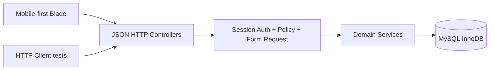
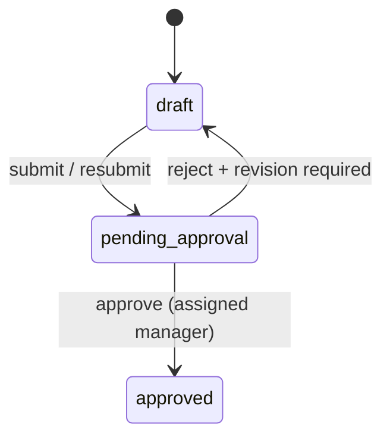

# TDD — Mobile Sales Force (MSF)

> **Versi:** 1.6 (technical baseline v1.5 + label UI v1.6).  
> **Status:** Approved design / unimplemented, unverified.  
> **Autoritas:** `DESIGN.md` (induk), `PRD.md` (perilaku), `API_CONTRACT.md` (HTTP), `DATABASE_SCHEMA.md` (persistensi), `TEST_PLAN.md` (acceptance).

## 1. Arsitektur dan batasan

**Laravel monolith**, HTML via Blade, interaksi `fetch` + JavaScript ringan (Alpine.js opsional), data MySQL 8.0.16+ InnoDB. Endpoint JSON `/api/*` dan tampilan Blade memanggil service yang sama. Tidak ada SPA terpisah, microservices, queues, atau domain event bus yang diwajibkan.



**Layering:**

- Controllers: HTTP parsing/response, authorize, delegasi.
- Form Requests: bentuk input dan validasi sintaks.
- Policies: actor, ownership, direct manager, object visibility.
- Services: aturan bisnis, lock dan transaksi lintas model, klasifikasi.
- Models: relasi Eloquent; jangan menaruh workflow lintas tabel dalam Blade/controller.
- DB migrations: unique/FK/check plus indeks retrieval.

**Auth penting:** Laravel session dengan CSRF untuk AJAX same-origin. Karena route `/api/*` default bisa stateless, pasang middleware cookie/session/CSRF+auth secara eksplisit (atau gunakan routes web prefix `/api`), jelaskan pilihan di README. `mr_id` selalu berasal dari session.

## 2. Service boundaries

| Service | Tanggung jawab | Prioritas |
|---|---|---|
| `CallListService` | Draft, edit, submit, assigned approver, owner/month | P0 |
| `CallListApprovalService` | Approve/reject direct manager, event log atomic | P0 |
| `CallPlanService` | Create/list, Schedule conflict, status updates ketika Actual | P0 |
| `CallActualService` | Validasi Planned/Without Plan, class snapshot, products, transaction | P0 |
| `VisitSessionService` | Check-in/out server, resume, revision, cancel | P1 |
| `ScheduleAvailabilityService` | Availability minimal + warning conflicts | P1 |

**Jangan menggandakan rules utama** antara Direct Actual dan Session-based Actual. Finalisasi melalui `CallActualService` yang sama.

## 3. State machines

### Call List



- State aktif DB: `draft`, `pending_approval`, `approved`.
- Events: `submitted`, `pending_approval`, `rejected`, `returned_to_draft`, `resubmitted`, `approved`.
- Event record memiliki `actor_id`, `event_origin: user_action|system_transition`, `from_status`,`to_status`, reason/timestamp.
- Jika reject, UI memperoleh `last_decision=rejected`, namun DB kembali `draft`.
- Submit pertama mengambil direct manager sebagai `assigned_approver_id`; resubmit memakai ID yang sama. Approved immutable.
- DM/RSM dapat membuat List sendiri sebagai asumsi agar seluruh chain hierarchy dapat didemokan.

### Call Plan

`scheduled -> completed` **hanya** ketika Actual final memakai `plan_id` Plan itu. `scheduled -> cancelled` melalui owner + reason (P1) bila tidak ada actual/sesi aktif terkait. No reverse transition. `conflicted` dan `unreported` adalah **computed UI indicators**, bukan status DB.

### Visit Session (P1)

`in_progress -> completed|cancelled`. Check-out disimpan sebagai timestamp, tidak mengubah status menjadi completed sampai Actual final sukses. Draft revision integer untuk optimistic concurrency; identity/timestamps immutable. Server time adalah satu-satunya sumber Check-in/out Session.

### Call Actual

Hanya record final di DB; *In Progress* pada P0 dapat berupa state formulir UI, bukan record Call Actual sementara. Simpan `visit_type` snapshot pada finalization. Actual immutable pada MVP.

## 4. Alur transaksi rinci

### 4.1 Submit Call List

1. Require auth; owner Draft; List mempunyai minimal satu dokter.
2. Transaction: lock Call List; jika first submit resolve direct manager dari `users.manager_id`, cocokkan role step MR→DM, DM→RSM, RSM→MM, simpan assigned approver.
3. Emit `submitted` / `resubmitted` user event; update List ke `pending_approval`; emit `pending_approval` system event.
4. Commit; return 200. Semua event dan state harus commit/rollback bersama.

### 4.2 Approve atau Reject

1. Auth role dan object scope: actor = assigned direct manager (role saja tidak cukup).
2. Lock Call List; pastikan `pending_approval`.
3. Approve → state Approved + approved_at + approval event; Reject → event rejected, state Draft, return_to_draft system event, reason wajib.
4. Commit; hasil 200; dua approval concurrent tidak boleh sama-sama berhasil.

### 4.3 Create Call Plan

1. Validasi format + owner, list approved, dokter anggota list, `plan_date` dalam bulan.
2. Mulai transaksi; lock `master_customers` row dokter `FOR UPDATE`.
3. Periksa tidak ada Plan non-Cancelled **global** maupun Actual final untuk dokter/tanggal.
4. Insert Plan Scheduled. Generated conditional unique index menjadi final backstop.
5. Commit; konflik 409. Jangan otomatis reserve/approve sesuatu.

### 4.4 Direct/Manual Call Actual P0

1. Auth MR, parse Direct payload sesuai PDF (`plan_id` nullable, date, time, photo, signature, `products[]`).
2. Tentukan dokter/tanggal dan timestamp lokal Asia/Jakarta; invalid/future time → 422 (future time asumsi).
3. Begin transaction. Lock doctor row. Lock Plan jika `plan_id` nonnull; cek Session in_progress yang konflik.
4. Pastikan belum ada Actual untuk `(doctor_id, visit_date)` **global**.
5. **Planned:** Plan owner MR, dokter cocok, Plan Scheduled, source List Approved, actual date dalam periode source list; jika beda `plan_date`, perlu deviation reason; jika Plan Scheduled **milik MR yang sama** untuk dokter tepat pada tanggal Actual dan Plan yang dipilih adalah Plan lain, tolak pemilihan salah (aturan khusus Planned).
6. **Without Plan:** dokter harus dari MCL; cari Call List Approved pemilik yang memasukkan dokter dan `approved_at <= check_in_at` pada bulan itu; `visit_type=unplanned` jika ada, else `non_target`.
7. Validasi foto, tanda tangan, products minimal satu, seluruh product ID valid dan distinct, checkout > checkin.
8. Insert Actual + pivot products. Jika Planned, ubah **Plan tersebut saja** menjadi Completed.
9. Commit and 201. Kegagalan relasi produk harus rollback Actual/Plan semuanya.

**Jika ada active Session milik MR sendiri pada dokter/tanggal sama:** direct finalization jangan diam-diam melewati Session; UI mengarahkan selesaikan Session atau Cancel dulu. Session oleh MR lain juga menolak direct completion saat aktif.

### 4.5 Visit Session P1

- **Start:** derive doctor dari Plan bila `plan_id` tersedia; doctor lock; cek Actual existing dan active Session. Insert Session `in_progress` dengan check-in server; duplicate request dari MR sama+plan yang sama mengembalikan 200 resume tanpa Check-in ulang.
- **Save Draft:** owner, Session `in_progress`, `expected_revision` harus sama; update `draft_payload`/revision saja, tidak update identity atau times. 409 stale revision.
- **Check-out:** owner, `in_progress`, `check_out_at` belum ada, set server time satu kali. Tetap `in_progress` sampai final completion.
- **Completion:** masuk ke `CallActualService`; `visit_session_id` mencari Plan/doctor/date/timestamps server. Validate `plan_id` equality **termasuk NULL**. Jika payload client mencampur/mengganti identity/time, tolak. Insert Actual + products + set Plan Completed (jika terhubung) + Session Completed pada satu transaksi.
- **Cancel:** hanya in_progress owner, cancellation reason, set cancelled_at dan status; jangan mengubah Plan. Session cancelled tidak otomatis mengunci tanggal baru.

### 4.6 Recovery

- Jika Session waktunya tidak akurat: UI menunjukkan guided wizard **Cancel Session → Form Manual Actual**, dua request HTTP berbeda. Jika request kedua gagal, Session tetap Cancelled; input form jangan hilang. Manual Actual boleh memakai Plan yang masih Scheduled sehingga finalisasi Planned tetap sah.
- Jika POST timeout: GET own Actual by doctor/date/plan. Jika existing ditemukan, buka record. Jika tidak, sediakan retry. Duplicate 409 own dapat menyertakan own Actual ID; duplicate lintas MR tidak boleh membeberkan ID/evidence.
- Conflict Call Plan akibat Actual tanpa relasi: derived indicator saja, tidak otomatis menyelesaikan/membatalkan Plan.

## 5. Concurrency dan lock ordering

**Lock shared doctor row** adalah koordinasi lintas tabel: unique Plan, unique Session, dan unique Actual **secara terpisah** tidak cukup mencegah Session aktif bersamaan dengan Actual final.

Lock order mutasi kunjungan:

1. Resolve Doctor ID (read-only prefetch boleh, jangan dipercaya sampai revalidasi).
2. Begin transaction.
3. Lock `master_customers` dokter via `FOR UPDATE`.
4. Lock `call_plans` terkait (jika ada).
5. Lock `visit_sessions` terkait (jika ada).
6. Baca ulang & validasi semua state setelah lock.
7. Insert/update; commit.

Lock dokter diperlukan untuk create Plan, cancel Plan, check-in, save/checkout/cancel Session, finalisasi Actual; service approval memakai lock Call List tersendiri. Deadlock/timeout DB → rollback, retry terbatas yang benar-benar aman diulang, lalu revalidasi. Unique violation → 409, tidak sembunyikan sebagai 500 generik.

## 6. Waktu

- Zona bisnis `Asia/Jakarta`; API memakai tanggal/jam lokal untuk Direct Actual, dikonversi ke timestamp UTC secara eksplisit untuk DB `DATETIME(6)`.
- Visit Date Session diambil dari tanggal lokal Check-in server; check-out lewat tengah malam tidak menggeser visit_date (waktu check-out harus setelah check-in).
- Direct API P0 menggunakan tanggal yang sama untuk input check-in dan check-out; kedua jam harus urut (`out > in`). **Lintas hari dengan Direct API** belum didukung (asumsi MVP).
- `completed_at` boleh jauh setelah `visit_date` untuk laporan terlambat. Planned Actual tetap harus berada di bulan List asal; Without Plan tidak perlu Approved List (hanya MCL) dan tidak dibatasi bulan List.
- Historical input dapat dipalsukan pengguna; jangan klaim adanya GPS/proof of physical attendance.

## 7. Authorization matrix

| Aksi | Izin |
|---|---|
| GET own Call Lists/Plans/Actuals | Owner login saja |
| GET single Call List | Owner / assigned approver sah |
| Edit/Submit Call List | Owner Draft |
| Approve/Reject | Assigned **direct manager** dan List Pending |
| Create Plan | MR, Approved source List miliknya |
| Create Actual | MR, Plan owner match bila ada |
| Visit Session read/update/cancel | Session owner MR saja |
| Conflict availability | Indikator minimum; tidak mengekspos MR lain/evidence |

## 8. UI structure

### 8.1 UI terminology & responsive navigation (v1.7 — presentation layer only)

`PRD.md` §4.0 adalah sumber kebenaran untuk label yang terlihat pengguna. Implementasi Blade menampilkan:

| Label menu / heading | Subtitle **di heading halaman** | Internal resource yang **tetap** dipakai |
|---|---|---|
| **Target Dokter** | Call List Bulanan | `call_lists`, `CallListController`, `/api/call-lists` |
| **Jadwal Kunjungan** | Call Plan | `call_plans`, `CallPlanController`, `/api/call-plans` |
| **Pelaksanaan Kunjungan** | Call Actual | `call_actuals`, `CallActualController`, `/api/call-actuals` |

**Responsive display rules:**

- **Desktop navigation:** pakai nama lengkap bahasa Indonesia; tidak wajib menampilkan subtitle pada item menu.
- **Narrow mobile navigation:** boleh menampilkan **Target**, **Jadwal**, **Kunjungan** jika dibutuhkan, dengan accessible name yang menjelaskan nama lengkap.
- **Page heading di semua viewport:** nama lengkap Indonesia + subtitle istilah PDF. Judul halaman tetap penuh walaupun navigasi diringkas.

Gunakan satu mapping label (Blade component/helper sederhana) agar konsisten. Jangan membuat infrastructure translation/i18n kompleks hanya untuk tiga menu.

**Technical safeguards:**

1. Perubahan hanya pada teks presentasi; path API, nama kelas/model, tabel, status DB, dan request JSON tidak diubah.
2. View tetap terdiri atas tepat tiga halaman utama; tab approval tetap dalam halaman **Target Dokter**.
3. **Derived Call List label precedence (evaluasi status aktif terlebih dahulu):** `approved` → **Disetujui**; `pending_approval` → **Menunggu Persetujuan**; `draft` + rejection event yang belum diikuti resubmit → **Perlu Revisi**, dengan reason penolakan terbaru; `draft` lainnya → **Draft**. Event rejection lama **tidak** boleh menimpa status setelah resubmit/approval. Jangan menambahkan persisted `rejected` state baru.
4. **P0 Direct Actual:** dari Jadwal Hari Ini gunakan **Isi Laporan Kunjungan**; input **Waktu Mulai/Waktu Selesai** manual, foto, TTD, dan produk; **Simpan Laporan** melakukan POST Direct Actual. State `in_progress` pada UI P0 bersifat lokal. Tidak ada server Check-in/Check-out action palsu.
5. **P1 Session:** **Mulai Kunjungan** melakukan POST Visit Session dan merekam Check-in server; **Akhiri Kunjungan** menyimpan Check-out server; **Simpan Laporan** baru melakukan finalisasi Actual. Checkout tidak mengubah Plan/Actual menjadi Completed tanpa finalisasi.
6. Semua alert, loading/error states, konfirmasi, validasi form, tombol, dan empty states menggunakan bahasa Indonesia yang operasional; kode `error_code` tetap internal untuk logika UI dan test automation.
7. Pengujian UI memastikan subtitle muncul pada **heading ketiga halaman**, navigasi desktop/mobile dapat beradaptasi, P0 tidak berpura-pura mempunyai Check-in/Check-out server, `Perlu Revisi` tidak tertinggal setelah resubmit, route/API tetap identik, dan P1 Check-out tidak menandai Actual Completed sebelum finalisasi.

```text
resources/
  views/
    layouts/app.blade.php
    auth/
    call-lists/
    call-plans/
    call-actuals/
    components/
  js/
    app.js
```

- Call List: Draft/Submitted-Pending/Approved + manager approval tab dan rejection reason.
- Call Plan: form Approved List → doctor → date/time; list dengan simple status + derived conflict.
- Call Actual: **Active Session** (P1) → **Jadwal Hari Ini** → **Kunjungan di Luar Rencana** → **Riwayat Selesai**. Satu guided panel untuk foto, TTD, products. **P0** menyediakan input waktu manual; **P1** memakai Check-in/Check-out server. Planned jadi default; Non Target/Unplanned diklasifikasikan backend.
- Fetch API menampilkan loading, error per-panel, duplicate response, action disable sementara request pending, serta 401 session expiry.
- Mobile responsive, label human-readable (hindari istilah `plan_id`, `deviation_reason` dalam UI).

## 9. Security dan operational limits

- Gunakan FormRequest, Policy, role hierarchy dan ownership; CSRF untuk cookie session.
- Jangan masukkan credential, env secrets, case study PDF, atau data pribadi asli ke repository publik.
- Foto dan signature adalah **mock URL** yang divalidasi sebagai URL; tidak ada upload fisik/GPS verification dalam P0.
- Session-based attendance is server-timestamped tetapi tidak membuktikan keberadaan fisik.
- Pending approval lama tidak auto-escalate; audit history ada, reminder optional P2.
- No mutation of already Approved List or final Actual without explicit future design.

## 10. Test gates dan dependency order

1. Project setup + login/session/CSRF tests.
2. Master tables/migrations/seeds + MySQL constraint tests.
3. List and approval lifecycle + role/manager tests.
4. Plan validation and uniqueness tests.
5. Actual Direct API Planned/Without Plan + transaction/retry tests.
6. 3 Blade pages + mobile flow; test all five PDF scenarios.
7. README install, assumptions, evidence, tools reflection.
8. Implement P1 Session/recovery **only if P0 stable**.

Refer `TEST_PLAN.md` for cases, `DATABASE_SCHEMA.md` for schema, and `IMPLEMENTATION_PLAN.md` for order and Definition of Done.
